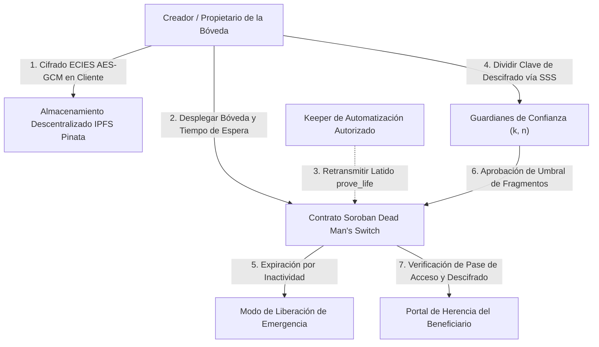

<div align="center">
  <h1>SpooVault 🔐 (Español)</h1>
  <p><strong>Protocolo de Custodia de Documentos sin Confianza (Trustless) e Interruptor de Hombre Muerto de Próxima Generación en Stellar y Soroban</strong></p>
  <p>
    <a href="../../../README.md">English</a> •
    <strong>Español</strong> •
    <a href="../zh/README.md">简体中文</a> •
    <a href="../fr/README.md">Français</a> •
    <a href="ARCHITECTURE.md">Arquitectura del Protocolo</a>
  </p>
</div>

---

## 📖 Resumen Ejecutivo

**SpooVault** es un protocolo autónomo y descentralizado de custodia de documentos Web3 y herencia digital diseñado nativamente sobre la **Red Stellar** utilizando **Contratos Inteligentes Soroban** (con soporte dual para **Avalanche EVM**). Revoluciona la preservación del legado digital y el resguardo de documentos confidenciales al eliminar el riesgo de contraparte custodial, la pérdida de claves por punto único de fallo y las demoras sucesorias mediante:

- Lógica automatizada en cadena de **Interruptor de Hombre Muerto (Dead Man's Switch)**.
- Consenso multi-guardián basado en **Shamir's Secret Sharing (SSS)** $(k, n)$.
- **Cifrado del lado del cliente de conocimiento cero (Zero-Knowledge)** con `AES-256-GCM` y `ECIES`.

Aprovechando la finalidad de libro mayor de 5 segundos de Stellar, comisiones de fracciones de centavo y la arquitectura del Protocolo 22, SpooVault garantiza que credenciales críticas, claves privadas, testamentos y secretos de gobernanza corporativa permanezcan impenetrables mientras el propietario esté activo, y se transfieran de forma segura a los beneficiarios designados si el latido (*heartbeat*) del propietario expira.

---

## 🌐 Despliegue en Vivo (Stellar Testnet)

| Recurso | Valor / Enlace Directo |
| :--- | :--- |
| **Red** | Stellar Testnet (Protocol 22) |
| **ID del Contrato** | [`CCYKK34DEO2BJABJQ7DW5MZ6PYFC7MRJYTZL2QPKBFCXHR4P347EUFZL`](https://stellar.expert/explorer/testnet/contract/CCYKK34DEO2BJABJQ7DW5MZ6PYFC7MRJYTZL2QPKBFCXHR4P347EUFZL) |
| **Explorador Stellar Expert** | [Ver Contrato en Stellar Expert](https://stellar.expert/explorer/testnet/contract/CCYKK34DEO2BJABJQ7DW5MZ6PYFC7MRJYTZL2QPKBFCXHR4P347EUFZL) |
| **Portal de Documentación** | [https://spoovault.web.app/docs](https://spoovault.web.app/docs) |
| **Aplicación Web en Producción** | [https://spoovault.web.app](https://spoovault.web.app) |

---

## 🏗️ Arquitectura del Sistema



### Pila Tecnológica Principal

- **Framework Frontend:** React 18, TypeScript 5.8, Vite, Tailwind CSS, HeroUI, Framer Motion.
- **Motor Web3:**
  - **Stellar SDK (`@stellar/stellar-sdk`):** Simulación RPC de Soroban, estimación de tarifas, análisis XDR y envío de transacciones.
  - **Freighter API (`@stellar/freighter-api`):** Firma mediante extensión de navegador de escritorio.
  - **Protocolo Albedo:** Puente web emergente sin instalación para billeteras móviles y de escritorio.
  - **WebAuthn / Passkeys:** Aislamiento biométrico por hardware (TouchID, FaceID, Windows Hello, YubiKey).
- **Contratos Inteligentes:** Soroban Rust (`#![no_std]`) con extensión automática de renta TTL, y Solidity (`SpooVault.sol`) en Avalanche Fuji.
- **Almacenamiento Descentralizado:** IPFS (Pinata) con agrupación de gateways, disyuntor (circuit breaker) y Recuperación Privada de Información (PIR).
- **Primitivas Criptográficas:** Cifrado de carga útil `AES-256-GCM` y `ECIES` (`Secp256k1` / `Ed25519`), recuperación por umbral polinómico `Shamir's Secret Sharing (SSS)`, derivación `Argon2id` y verificación de PIN `OPAQUE` (RFC 9807).

---

## 🎯 Centros de Comando Basados en Roles (RBAC)

### 1. 📢 Creador / Propietario de Bóveda
- **Despliegue de Bóvedas Inteligentes:** Configure intervalos de latido (*heartbeat*) personalizados (p. ej., 30 días, 90 días, 1 año).
- **Encapsulación de Documentos de Conocimiento Cero:** Cifrado en el navegador antes de registrar los CIDs de IPFS en el libro mayor de Stellar.
- **Relés Keeper Delegados:** Autorice relés automatizados para enviar `prove_life()` sin conceder acceso al contenido de la bóveda.

### 2. 🤝 Multi-Firma de Guardianes de Confianza
- **Aceptación de Guardianes:** Acepte invitaciones criptográficas en cadena y registre claves públicas de recuperación.
- **Aprobaciones por Umbral:** Custodie fragmentos polinómicos SSS y vote criptográficamente para autorizar el acceso de emergencia.
- **Agregación de Firmas BLS:** Combine firmas de guardianes en pruebas criptográficas compactas.

### 3. 🔍 Portal de Herencia para Beneficiarios
- **Reclamación de Herencia:** Solicite acceso a bóvedas vencidas cuando expire el temporizador de inactividad del propietario.
- **Descifrado en el Navegador:** Reconstruya los fragmentos de Shamir localmente para descargar y descifrar activos digitales, testamentos y claves privadas.
- **Pases de Acceso NFT:** Credenciales tokenizadas que demuestran la titularidad legítima del beneficiario.

---

## 🚀 Guía de Inicio Rápido

### Requisitos Previos
- **Node.js:** v18.0.0 o superior (se recomienda v20+)
- **npm:** v10.0.0 o superior
- **Billetera Stellar:** [Freighter](https://www.freighter.app/) o [Albedo](https://albedo.link/)

### 1. Clonar e Instalar
```bash
git clone https://github.com/spoo-vault/spoovault.git
cd spoovault
npm install --legacy-peer-deps
```

### 2. Configurar Variables de Entorno (`.env`)
```env
VITE_STELLAR_NETWORK=TESTNET
VITE_STELLAR_HORIZON_URL=https://horizon-testnet.stellar.org
VITE_STELLAR_SOROBAN_RPC_URL=https://soroban-testnet.stellar.org
VITE_STELLAR_NETWORK_PASSPHRASE="Test SDF Network ; September 2015"
VITE_STELLAR_CONTRACT_ADDRESS=CCYKK34DEO2BJABJQ7DW5MZ6PYFC7MRJYTZL2QPKBFCXHR4P347EUFZL
VITE_CONTRACT_ADDRESS=CCYKK34DEO2BJABJQ7DW5MZ6PYFC7MRJYTZL2QPKBFCXHR4P347EUFZL
```

### 3. Iniciar Servidor de Desarrollo
```bash
npm run dev
```

### 4. Ejecutar Pruebas y Validación
```bash
# Ejecutar las 94 pruebas de contratos inteligentes Soroban en Rust
npm run test:stellar

# Ejecutar las suites de pruebas frontend con Vitest
npm test -- --run

# Verificación de tipos TypeScript y compilación de producción
npx tsc --noEmit
npm run build
```

---

## 🤝 Contribuir a las Traducciones

Consulte la [Guía de Internacionalización (`docs/i18n/README.md`)](../README.md) y la [Arquitectura del Sistema en Español (`ARCHITECTURE.md`)](ARCHITECTURE.md) para revisar o mejorar esta traducción.
