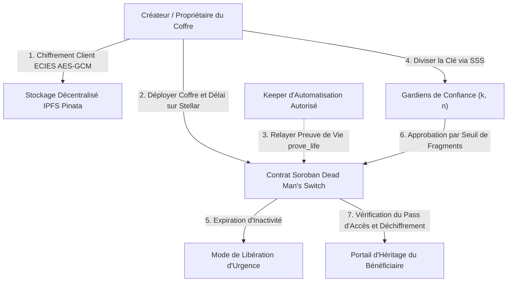

<div align="center">
  <h1>SpooVault 🔐 (Français)</h1>
  <p><strong>Protocole de Garde de Documents sans Tiers de Confiance (Trustless) et d'Interrupteur de l'Homme Mort de Nouvelle Génération sur Stellar & Soroban</strong></p>
  <p>
    <a href="../../../README.md">English</a> •
    <a href="../es/README.md">Español</a> •
    <a href="../zh/README.md">简体中文</a> •
    <strong>Français</strong> •
    <a href="ARCHITECTURE.md">Architecture du Protocole</a>
  </p>
</div>

---

## 📖 Résumé Exécutif

**SpooVault** est un protocole Web3 autonome et décentralisé de garde de documents et d'héritage numérique conçu nativement sur le **Réseau Stellar** à l'aide des **Contrats Intelligents Soroban** (avec prise en charge double chaîne sur **Avalanche EVM**). Il révolutionne la préservation du patrimoine numérique et la protection des documents sensibles en éliminant le risque de contrepartie dépositaire, la perte de clés à point de défaillance unique et les délais successoraux opaques grâce à :

- Une logique automatisée sur chaîne d'**Interrupteur de l'Homme Mort (Dead Man's Switch)**.
- Un consensus multi-gardiens basé sur le **Partage de Secret de Shamir (SSS)** $(k, n)$.
- Un **chiffrement côté client à divulgation nulle de connaissance (Zero-Knowledge)** via `AES-256-GCM` et `ECIES`.

En tirant parti de la finalité de registre en 5 secondes de Stellar, de frais infimes et de l'architecture Protocol 22, SpooVault garantit que les identifiants critiques, clés privées, testaments et secrets de gouvernance d'entreprise restent impénétrables du vivant du propriétaire, tout en étant transmis de manière fiable aux bénéficiaires désignés en cas d'expiration du signal de vie (*heartbeat*).

---

## 🌐 Déploiement en Direct sur Stellar Testnet

| Ressource | Valeur / Lien Direct |
| :--- | :--- |
| **Réseau** | Stellar Testnet (Protocol 22) |
| **ID du Contrat** | [`CCYKK34DEO2BJABJQ7DW5MZ6PYFC7MRJYTZL2QPKBFCXHR4P347EUFZL`](https://stellar.expert/explorer/testnet/contract/CCYKK34DEO2BJABJQ7DW5MZ6PYFC7MRJYTZL2QPKBFCXHR4P347EUFZL) |
| **Explorateur Stellar Expert** | [Voir le Contrat sur Stellar Expert](https://stellar.expert/explorer/testnet/contract/CCYKK34DEO2BJABJQ7DW5MZ6PYFC7MRJYTZL2QPKBFCXHR4P347EUFZL) |
| **Portail de Documentation** | [https://spoovault.web.app/docs](https://spoovault.web.app/docs) |
| **Application Web en Production** | [https://spoovault.web.app](https://spoovault.web.app) |

---

## 🏗️ Architecture du Système



### Pile Technologique Principale

- **Framework Frontend :** React 18, TypeScript 5.8, Vite, Tailwind CSS, HeroUI, Framer Motion.
- **Moteur Web3 :**
  - **Stellar SDK (`@stellar/stellar-sdk`) :** Simulation RPC Soroban, estimation des frais, analyse XDR et soumission de transactions.
  - **Freighter API (`@stellar/freighter-api`) :** Signature via extension de navigateur sur ordinateur.
  - **Protocole Albedo :** Pont web sans installation pour la signature sur mobile et ordinateur.
  - **WebAuthn / Passkeys :** Isolation biométrique matérielle des clés (TouchID, FaceID, Windows Hello, YubiKey).
- **Contrats Intelligents :** Soroban Rust (`#![no_std]` avec extension automatique du loyer TTL) et Solidity (`SpooVault.sol`) sur Avalanche Fuji.
- **Stockage Décentralisé :** IPFS (Pinata) avec pool de passerelles, disjoncteur (circuit breaker) et Récupération Privée d'Information (PIR).
- **Primitives Cryptographiques :** Chiffrement `ECIES` (`Secp256k1` & `Ed25519`), récupération polynomiale à seuil `Shamir's Secret Sharing (SSS)` $(k, n)$, dérivation `Argon2id` et vérification de code PIN `OPAQUE` (RFC 9807).

---

## 🎯 Centres de Commande Basés sur les Rôles (RBAC)

### 1. 📢 Créateur / Propriétaire du Coffre
- **Déploiement de Coffres Intelligents :** Créez des coffres Soroban sur chaîne avec des intervalles de preuve de vie configurables (ex. 30 jours, 90 jours, 1 an).
- **Encapsulation Zero-Knowledge :** Chiffrez les documents côté client avec `AES-256-GCM` avant d'inscrire les hachages IPFS sur le registre Stellar.
- **Relais Keeper Délégués :** Autorisez des relais automatisés en arrière-plan à soumettre `prove_life()` sans jamais leur donner accès au contenu du coffre.

### 2. 🤝 Multi-Signature des Gardiens de Confiance
- **Acceptation des Gardiens :** Acceptez les invitations cryptographiques sur chaîne et enregistrez les clés publiques de récupération.
- **Approbations à Seuil :** Détenez des fragments polynomiaux SSS et votez cryptographiquement pour autoriser l'accès d'urgence.
- **Agrégation de Signatures BLS :** Agrégez les signatures des gardiens en preuves cryptographiques compactes.

### 3. 🔍 Portail d'Héritage des Bénéficiaires
- **Réclamation d'Héritage :** Soumettez des demandes d'accès aux coffres arrivés à échéance lorsque le minuteur d'inactivité du propriétaire expire.
- **Déchiffrement dans le Navigateur :** Réassemblez les fragments de Shamir localement pour télécharger et déchiffrer les actifs numériques, testaments et clés privées.
- **Pass d'Accès NFT :** Identifiants d'autorisation tokenisés prouvant la propriété légitime du bénéficiaire sur Stellar.

---

## 🚀 Guide de Démarrage Rapide

### Prérequis
- **Node.js :** v18.0.0 ou supérieur (v20+ recommandé)
- **npm :** v10.0.0 ou supérieur
- **Portefeuille Stellar :** [Freighter](https://www.freighter.app/) ou [Albedo](https://albedo.link/)

### 1. Cloner et Installer
```bash
git clone https://github.com/spoo-vault/spoovault.git
cd spoovault
npm install --legacy-peer-deps
```

### 2. Configurer l'Environnement (`.env`)
```env
VITE_STELLAR_NETWORK=TESTNET
VITE_STELLAR_HORIZON_URL=https://horizon-testnet.stellar.org
VITE_STELLAR_SOROBAN_RPC_URL=https://soroban-testnet.stellar.org
VITE_STELLAR_NETWORK_PASSPHRASE="Test SDF Network ; September 2015"
VITE_STELLAR_CONTRACT_ADDRESS=CCYKK34DEO2BJABJQ7DW5MZ6PYFC7MRJYTZL2QPKBFCXHR4P347EUFZL
VITE_CONTRACT_ADDRESS=CCYKK34DEO2BJABJQ7DW5MZ6PYFC7MRJYTZL2QPKBFCXHR4P347EUFZL
```

### 3. Lancer le Serveur de Développement
```bash
npm run dev
```

### 4. Tests et Validation
```bash
# Exécuter les 94 tests de contrats intelligents Soroban Rust
npm run test:stellar

# Exécuter les suites de tests frontend Vitest
npm test -- --run

# Vérification des types TypeScript et build de production
npx tsc --noEmit
npm run build
```

---

## 🤝 Contribuer aux Traductions

Consultez le [Guide d'Internationalisation (`docs/i18n/README.md`)](../README.md) ainsi que le [Résumé de l'Architecture en Français (`ARCHITECTURE.md`)](ARCHITECTURE.md) pour réviser ou enrichir cette traduction.
