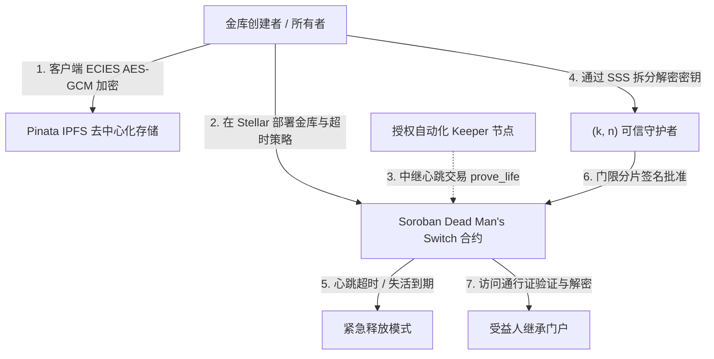

<div align="center">
  <h1>SpooVault 🔐 (简体中文)</h1>
  <p><strong>基于 Stellar 与 Soroban 的下一代去信任化文档托管与失能开关（Dead Man's Switch）协议</strong></p>
  <p>
    <a href="../../../README.md">English</a> •
    <a href="../es/README.md">Español</a> •
    <strong>简体中文</strong> •
    <a href="../fr/README.md">Français</a> •
    <a href="ARCHITECTURE.md">协议系统架构</a>
  </p>
</div>

---

## 📖 执行摘要

**SpooVault** 是一个原生构建于 **Stellar 网络** 并采用 **Soroban 智能合约**（同时支持 **Avalanche EVM** 双链运行）的自主、去中心化 Web3 文档托管与数字遗产继承协议。通过消除托管方对手风险、单点私钥丢失风险以及繁琐不透明的遗产认证延迟，SpooVault 彻底革新了数字遗产保护与机密文档安全托管：

- **链上自动化失能开关（Dead Man's Switch）** 逻辑。
- **Shamir 秘密共享（SSS）** $(k, n)$ 多守护者门限共识机制。
- **零知识客户端加密（Zero-Knowledge Client-Side Encryption）**，采用 `AES-256-GCM` 与 `ECIES`。

依托 Stellar 网络 5 秒账本最终确认、极低交易手续费以及 Protocol 22 架构，SpooVault 确保关键凭证、私钥、遗嘱与企业治理机密在所有者活跃期间坚不可摧，并在所有者心跳（Heartbeat）超时后安全、可靠地移交至指定受益人。

---

## 🌐 Stellar 测试网实时部署

| 资源 | 值 / 直接链接 |
| :--- | :--- |
| **网络** | Stellar Testnet (Protocol 22) |
| **合约 ID** | [`CCYKK34DEO2BJABJQ7DW5MZ6PYFC7MRJYTZL2QPKBFCXHR4P347EUFZL`](https://stellar.expert/explorer/testnet/contract/CCYKK34DEO2BJABJQ7DW5MZ6PYFC7MRJYTZL2QPKBFCXHR4P347EUFZL) |
| **Stellar Expert 浏览器** | [在 Stellar Expert 上查看实时合约](https://stellar.expert/explorer/testnet/contract/CCYKK34DEO2BJABJQ7DW5MZ6PYFC7MRJYTZL2QPKBFCXHR4P347EUFZL) |
| **公共文档门户** | [https://spoovault.web.app/docs](https://spoovault.web.app/docs) |
| **生产环境 Web 应用** | [https://spoovault.web.app](https://spoovault.web.app) |

---

## 🏗️ 系统架构



### 核心技术栈

- **前端框架：** React 18、TypeScript 5.8、Vite、Tailwind CSS、HeroUI、Framer Motion。
- **Web3 引擎：**
  - **Stellar SDK (`@stellar/stellar-sdk`)：** Soroban RPC 模拟、费用估算、XDR 解析与交易提交。
  - **Freighter API (`@stellar/freighter-api`)：** 桌面浏览器扩展签名支持。
  - **Albedo 协议：** 面向移动端与桌面端的免安装 Web 弹窗签名桥。
  - **WebAuthn / Passkeys：** 硬件级生物识别密钥隔离（TouchID、FaceID、Windows Hello、YubiKey）。
- **智能合约：** Soroban Rust（`#![no_std]`，支持持久化存储托管与自动 TTL 租金续期）及 Avalanche Fuji Solidity（`SpooVault.sol`）。
- **去中心化存储：** IPFS（Pinata），配备多网关连接池、熔断器（Circuit Breaker）与隐私信息检索（PIR）。
- **密码学原语：** `ECIES`（`Secp256k1` 与 `Ed25519`）载荷加密、`Shamir's Secret Sharing (SSS)` $(k, n)$ 多项式门限恢复、`Argon2id` 内存硬化密钥派生及 `OPAQUE` PIN 验证（RFC 9807）。

---

## 🎯 基于角色的指挥中心 (RBAC)

### 1. 📢 金库创建者 / 所有者 (Vault Creator / Owner Pro)
- **部署智能金库：** 创建链上 Soroban 托管金库，支持可配置的心跳周期（如 30 天、90 天、1 年）。
- **零知识文档封装：** 在将 IPFS 哈希写入 Stellar 账本前，于客户端使用 `AES-256-GCM` 完成文档加密。
- **委托 Keeper 中继：** 授权自动化后台中继器提交 `prove_life()`，同时不授予 Keeper 任何金库内容访问权限。

### 2. 🤝 可信守护者多签 (Trusted Guardian Multi-Sig)
- **守护者接受邀请：** 在链上接受加密邀请并注册恢复公钥。
- **门限分片批准：** 持有 Shamir 秘密共享多项式分片，并在验证所有者失活后通过密码学投票授权紧急访问。
- **BLS 签名聚合：** 将多个守护者签名聚合为紧凑的密码学证明。

### 3. 🔍 受益人继承门户 (Beneficiary Inheritance Portal)
- **申领数字遗产：** 当所有者失活计时器到期后，向到期金库提交访问请求。
- **浏览器端解密：** 在浏览器本地重组 Shamir 密钥分片，下载并解密高价值数字资产、遗嘱与私钥。
- **NFT 访问通行证：** 在 Stellar 链上证明受益人合法所有权的代币化授权凭证。

---

## 🚀 快速开始指南

### 环境要求
- **Node.js：** v18.0.0 或更高版本（推荐 v20+）
- **npm：** v10.0.0 或更高版本
- **Stellar 钱包：** [Freighter](https://www.freighter.app/)（桌面端）或 [Albedo](https://albedo.link/)（移动端 / Web）

### 1. 克隆与安装
```bash
git clone https://github.com/spoo-vault/spoovault.git
cd spoovault
npm install --legacy-peer-deps
```

### 2. 配置环境变量 (`.env`)
```env
VITE_STELLAR_NETWORK=TESTNET
VITE_STELLAR_HORIZON_URL=https://horizon-testnet.stellar.org
VITE_STELLAR_SOROBAN_RPC_URL=https://soroban-testnet.stellar.org
VITE_STELLAR_NETWORK_PASSPHRASE="Test SDF Network ; September 2015"
VITE_STELLAR_CONTRACT_ADDRESS=CCYKK34DEO2BJABJQ7DW5MZ6PYFC7MRJYTZL2QPKBFCXHR4P347EUFZL
VITE_CONTRACT_ADDRESS=CCYKK34DEO2BJABJQ7DW5MZ6PYFC7MRJYTZL2QPKBFCXHR4P347EUFZL
```

### 3. 启动本地开发服务器
```bash
npm run dev
```

### 4. 运行测试与验证
```bash
# 运行全部 94 个 Soroban Rust 智能合约测试（含 10,000 状态不变量模糊测试）
npm run test:stellar

# 运行前端 Vitest 测试套件
npm test -- --run

# TypeScript 类型检查与生产构建验证
npx tsc --noEmit
npm run build
```

---

## 🤝 参与翻译与审校

欢迎全球社区开发者审校或改进本文档！请参阅 [多语言文档贡献指南 (`docs/i18n/README.md`)](../README.md) 以及 [中文系统架构文档 (`ARCHITECTURE.md`)](ARCHITECTURE.md)。
